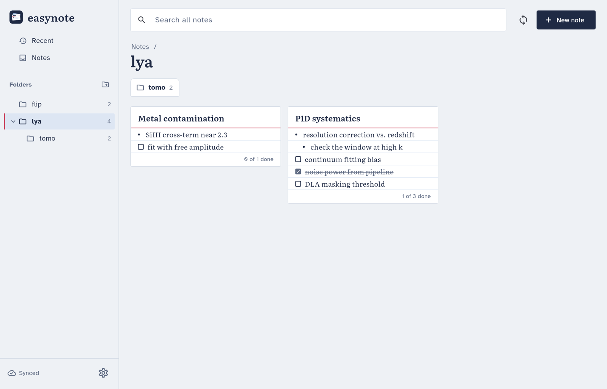
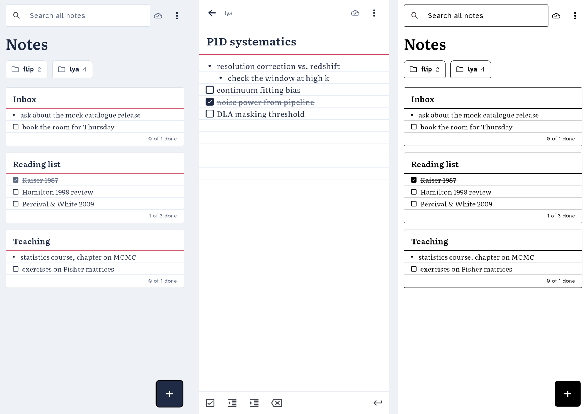

<p align="center">
  
</p>

<h1 align="center">easynote</h1>

<p align="center">
  Plain notes on Linux and Android, stored as Markdown in a GitHub repository of your own.
</p>

<p align="center">
  <a href="https://github.com/corentinravoux/easynote/releases/latest/download/easynote.apk"><b>Android APK</b></a>
  &nbsp;|&nbsp;
  <a href="https://github.com/corentinravoux/easynote/releases/latest/download/easynote-linux-x64.tar.gz"><b>Linux x64</b></a>
  &nbsp;|&nbsp;
  <a href="https://github.com/corentinravoux/easynote/releases">All releases</a>
</p>



A note is a title, bullets and checkboxes, nothing else. Notes live in
nested folders. Each device keeps a full copy and syncs only when the app
opens and when you close a note, so there is no server to run and nothing
running in the background.

- **Desktop:** a folder tree, a grid of note cards, and search across all
  notes, with or without accents.
- **Android (phone, e-ink tablet):** the same app, plus a home-screen widget
  listing your recent notes.
- **Your data:** plain `.md` files in a private repository. They are
  readable on github.com, every change is a commit, and you can leave
  easynote at any time.

<p align="center">
  
</p>

## Set up

1. On github.com, create a **private** repository for your notes and give it
   a README, since the app needs at least one commit.
2. Create a [fine-grained personal access
   token](https://github.com/settings/personal-access-tokens/new) with
   access to **only that repository** and the permission
   **Contents: read and write**.
3. Install easynote (see below). Open **Settings**, fill in owner,
   repository and token, then press **Test connection**.

Do the same on each device and give each one its own device name (`laptop`,
`phone`…). The name appears in commit messages and in the names of conflict
copies.

## Install

**Android.** Open
[easynote.apk](https://github.com/corentinravoux/easynote/releases/latest/download/easynote.apk)
on the device and install it. Android asks once to allow installs from your
browser. To add the widget, long-press the home screen, choose Widgets, then
*Recent notes*. On an e-ink tablet, turn on **E-ink mode** in Settings: it
gives black on white with no animations.

**Linux.**

```bash
curl -LO https://github.com/corentinravoux/easynote/releases/latest/download/easynote-linux-x64.tar.gz
curl -LO https://raw.githubusercontent.com/corentinravoux/easynote/main/scripts/install-linux.sh
bash install-linux.sh easynote-linux-x64.tar.gz
```

The app installs into `~/.local/share/easynote/app` with a menu entry. Run
the same commands again to update.

> [!NOTE]
> Releases are not yet signed with a permanent key, so Android may refuse
> to install a new version over an old one ("App not installed"). Uninstall
> easynote and install the new APK. Your notes are safe on GitHub; only the
> settings need re-entering.

## How it works

The repository *is* the note tree. A folder is a directory, at any depth,
and a note is a Markdown file:

```markdown
# Lyα tomography
- void finder on the reconstructed maps
  - a sub-item, indented two spaces
- [ ] check the Wiener filter
- [x] compare with VIDE
```

- **Unknown lines are kept.** A paragraph, or a line typed on github.com,
  stays exactly as written. The app only rewrites what you edit. Hidden
  files, non-Markdown files and the top-level `README.md` are ignored.
- **When it syncs.** The app pulls when it opens (and when Android brings it
  back to the front). It pushes when you close a note, press Ctrl+S, or
  switch away on Android. While you type, text is saved to disk every
  second, so nothing waits on the network.
- **One save is one commit.** A folder move is a single commit too.
- **Conflicts never lose text.** If two devices change the same note before
  syncing, the other device's version stays at the original path and yours
  is saved next to it as `<name>.conflict-<device>-<date>.md`. The copy is
  marked in the grid; merge by hand and delete it.
- **Offline is fine.** Changes wait on disk and go out at the next sync.

**Privacy.** The token stays in the system keyring: GNOME Keyring on Linux,
the Keystore on Android. Notes are **not encrypted**. GitHub, and anyone
with access to the repository, can read them, so keep passwords out.

## Keys

| key | in the grid | in a note |
|---|---|---|
| Ctrl+N | new note | |
| Ctrl+F | search | |
| F5 | sync now | |
| Enter | | new item (on an empty indented item: outdent) |
| Tab / Shift+Tab | | indent / outdent |
| Ctrl+Enter | | bullet ↔ checkbox |
| Backspace on an empty item | | delete it |
| Ctrl+S | | save and sync |
| Esc | | close and sync |

On the phone, the bar above the keyboard has the same actions.

<details>
<summary><b>Where things are stored</b></summary>

| what | Linux | Android |
|---|---|---|
| notes (a copy of the repository) | `~/.local/share/io.easynote.app/notes/`, or the folder set in Settings | app storage |
| settings | `~/.local/share/io.easynote.app/settings.json` | app storage |
| sync state | `~/.local/share/io.easynote.app/sync_state.json` | app storage |
| token | GNOME Keyring | Android Keystore |

</details>

## Build from source

Requires Flutter (stable). For Linux you also need
`clang cmake ninja-build pkg-config libgtk-3-dev libsecret-1-dev`.

```bash
flutter test                  # unit and widget tests
flutter build linux --release
flutter build apk --release   # signed if android/key.properties exists
scripts/install-linux.sh      # install the local Linux build
```

- **Live sync test.** `flutter test test/live` runs against GitHub when
  `EASYNOTE_TEST_TOKEN` and `EASYNOTE_TEST_REPO` are set, plus
  `EASYNOTE_TEST_BRANCH` for a throwaway branch. It only touches
  `easynote-live-test/` and cleans up.
- **Screenshots.** `flutter test tool/screens --update-goldens` renders the
  main screens to `tool/screens/out/`.
- **Icons.** `python3 tool/make_icons.py` regenerates every icon from the
  SVG masters in `assets/icon/`. It needs Inkscape.
- **Linux renderer.** Linux uses the Skia renderer, because Impeller's
  OpenGL backend left stale frames after resizing. Set `EASYNOTE_IMPELLER=1`
  to try Impeller.

<details>
<summary><b>Code layout</b></summary>

| path | what |
|---|---|
| `lib/format/` | note parser and serialiser, file-name slugs |
| `lib/store/` | the local copy: atomic writes, folders, moves, recent notes |
| `lib/sync/` | the sync engine and its GitHub client (Git Data API) |
| `lib/app/` | settings, token storage, app state |
| `lib/ui/` | theme, folder tree, card grid, editor, settings |
| `android/app/src/main/kotlin/` | the home-screen widget (Jetpack Glance) |

</details>

<details>
<summary><b>Release signing</b></summary>

Android installs an update only if it carries the same signature as the
installed app. To sign with a permanent key, create a keystore once and
keep it, with its password, in a password manager:

```bash
keytool -genkeypair -v -keystore easynote-release.jks -keyalg RSA \
  -keysize 4096 -validity 36500 -alias easynote
```

For local builds, write `android/key.properties`, which git ignores:

```properties
storeFile=/absolute/path/to/easynote-release.jks
storePassword=…
keyAlias=easynote
keyPassword=…
```

For releases built by GitHub, add the repository secrets:
- `ANDROID_KEYSTORE_B64` (`base64 -w0 easynote-release.jks`)
- `ANDROID_KEYSTORE_PASSWORD`
- `ANDROID_KEY_ALIAS`
- `ANDROID_KEY_PASSWORD`

Then push a tag `v*`.

</details>

## Not included, on purpose

- Rich text, images and attachments.
- Encryption.
- Background sync.
- Merging conflicts inside the app.
- Tags.
- A trash: deleted notes stay in the repository's history on GitHub.

## Licence

MIT. Bundled fonts: Literata and Atkinson Hyperlegible, both under the SIL
Open Font License (see `assets/fonts/`).
